<a href="https://plat.plus/en">
  <picture>
    <source media="(prefers-color-scheme: dark)" srcset="./banner-dark.svg">
    
  </picture>
</a>

<p align="center">
  <a href="https://plat.plus/en"></a>
  <a href="https://plat.plus/demo"></a>
  <a href="https://glama.ai/mcp/connectors/plus.plat/assistant"></a>
</p>

<p align="center">
  Notifications, meetings, questions to everyone in the room, course page, sessions and submissions in one place,<br>
  and anything interactive you create with your own AI. <b>Set up in minutes, on the phone too.</b>
</p>

<table>
  <tr>
    <td width="33%" valign="top"><h3>Notifications on every device</h3>plat.plus installs as an app and shows new tasks, feedback and messages right on phones and computers.</td>
    <td width="33%" valign="top"><h3>Meetings in the course</h3>Every course has its own meeting, always at the same link, and everyone has a personal meeting room for office hours.</td>
    <td width="33%" valign="top"><h3>Submissions and feedback</h3>Students hand in, and you write feedback and release it when you're ready.</td>
  </tr>
  <tr>
    <td valign="top"><h3>Questions for everyone in the room</h3>Everyone answers on their phone, even without an account. The result appears on the big screen and on every phone.</td>
    <td valign="top"><h3>Writing together</h3>Several people write notes and group work at the same time, right in the course.</td>
    <td valign="top"><h3>Upload once, see it everywhere</h3>Course page, session or task: every file lives once in Files and shows wherever you use it.</td>
  </tr>
  <tr>
    <td colspan="3" valign="top"><h3>Create interactive content with your own AI</h3>Describe flashcards, a quiz, a simulation or anything else, and an AI of your choice writes it for your course page, also one running on your own computer, such as in Ollama or LM Studio. You choose the AI and so who sees your content. plat.plus itself sends nothing to any AI.</td>
  </tr>
</table>

## Your courses in your AI assistant

Connect plat.plus to Claude, ChatGPT, Le Chat, Perplexity or a local model in LM Studio or Jan, and ask about your courses in plain language: *"What's due this week?"*, *"Summarize the page for tomorrow's session."* The assistant reads with your rights, sees other people under a code instead of their name, can't change anything, and you can disconnect it at any time.

```text
https://plat.plus/mcp
```

[How to connect](https://plat.plus/en/help#assistants-connect) · listed in the [official MCP Registry](https://registry.modelcontextprotocol.io/) as `plus.plat/assistant`

---

<p align="center">
  <a href="https://plat.plus/en">plat.plus</a> ·
  <a href="https://plat.plus/en/help">Help</a> ·
  <a href="https://plat.plus/en/datenschutz">Privacy</a> ·
  <a href="https://plat.plus/en/impressum">Imprint</a><br>
  <sub>Hosted in Germany.</sub>
</p>
